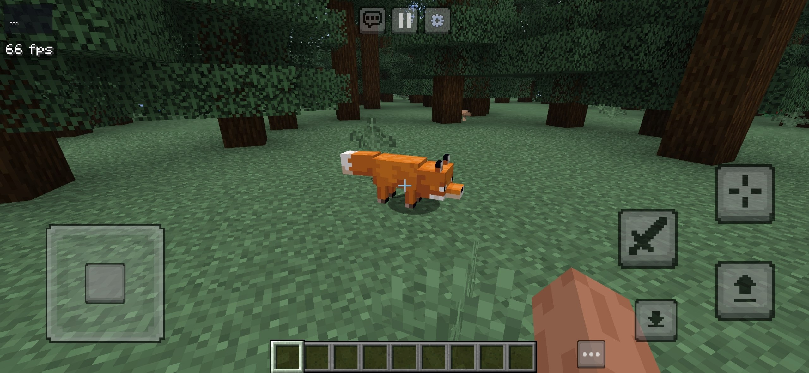
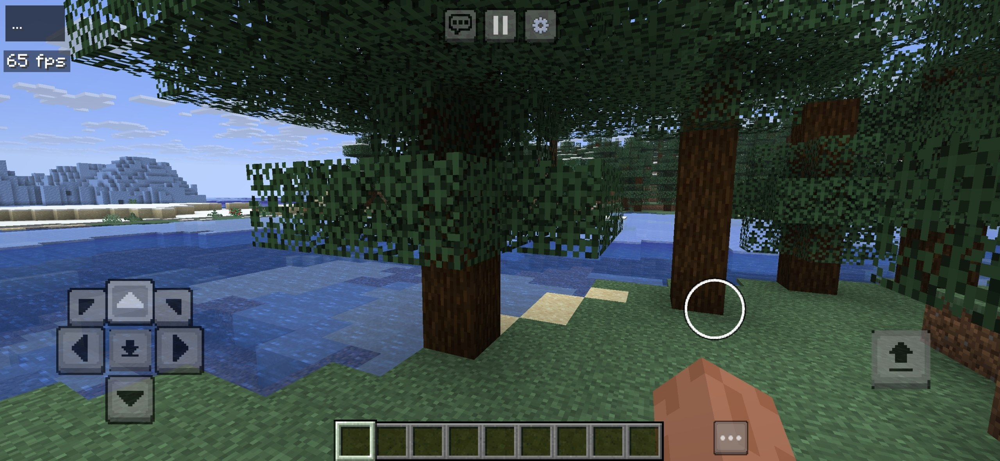
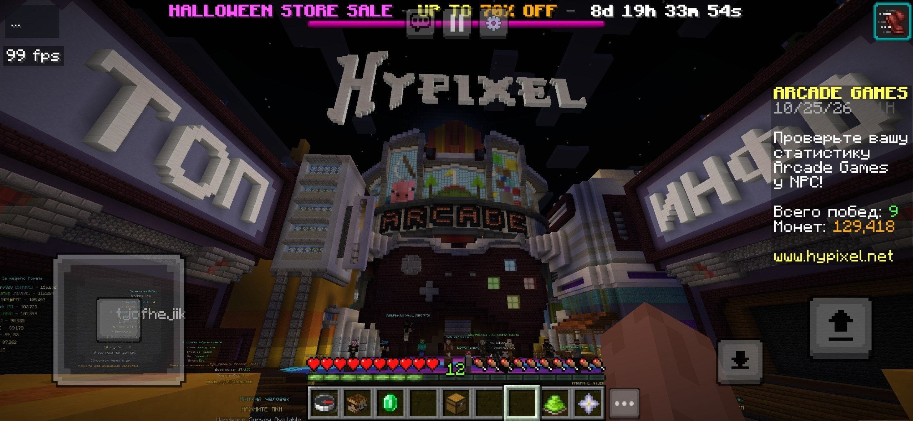
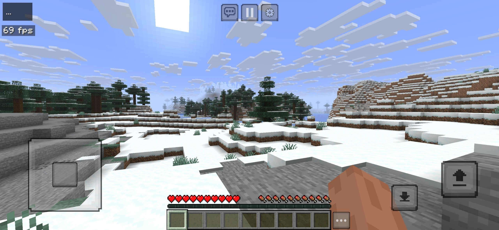

<div align="center">

```
  █████╗ ██████╗ ███████╗██╗  ██╗
 ██╔══██╗██╔══██╗██╔════╝╚██╗██╔╝
 ███████║██████╔╝█████╗   ╚███╔╝ 
 ██╔══██║██╔═══╝ ██╔══╝   ██╔██╗ 
 ██║  ██║██║     ███████╗██╔╝ ██╗
 ╚═╝  ╚═╝╚═╝     ╚══════╝╚═╝  ╚═╝
```

# Apex

**High-Performance Native Android Client for Minecraft Java 26.3**  
*Pure Ahead-of-Time Rust · Direct Vulkan Pipeline · Zero JVM Overhead*

[-2ea44f?style=flat-square)](#system-requirements)
[](#system-requirements)
[](#system-requirements)
[](#system-requirements)
[](#system-requirements)
[](LICENSE)

[Download APK](https://github.com/tubers9999/apex/releases) · [Build Instructions](docs/android.md) · [Issue Tracker](https://github.com/tubers9999/apex/issues) · [Contributing](CONTRIBUTING_ANDROID.md)

</div>

---

## [>] Overview

**Apex** is an ultra-fast, native Android port of the Minecraft Java Edition (target version 26.3) engine written from scratch in pure **Rust**. Unlike conventional wrappers that run desktop Java binaries inside an emulated JVM / Dalvik environment on top of Android, Apex compiles directly to native AArch64 machine code, rendering via Vulkan with zero Java Virtual Machine overhead.

The result is instant cold boots (<1.5 seconds), minimal RAM utilization (~150MB), silky-smooth frame pacing, and competitive PvP features designed specifically for mobile hardware.

---

## [>] Performance & Architecture Comparison

| Metric / Dimension | Apex Client | PojavLauncher | Minecraft Bedrock |
| :--- | :---: | :---: | :---: |
| **Core Architecture** | Native Ahead-of-Time Rust | OpenJDK HotSpot JVM | Native C++ |
| **Memory Footprint** | **~140 - 220 MB** | 1,200 - 2,500 MB | ~400 - 800 MB |
| **Cold Boot Duration** | **< 1.5 seconds** | 15 - 35 seconds | 4 - 8 seconds |
| **Graphics Pipeline** | **Direct Vulkan (WGSL/Naga)** | OpenGL via GL4ES | Direct3D / Vulkan |
| **Built-in Keystrokes & CPS** | **Integrated Native HUD** | Requires Forge/Fabric mods | Unavailable |
| **1-Tap Ultra FPS Booster** | **Native Culling Engine** | Requires external mods | Limited sliders |
| **PvP Hitmarker Sound** | **Zero-latency PCM Synthesizer** | Requires mod packs | Resource pack hack |
| **Touch Layout Engine** | **GoyControl & MCPE Polygons** | Virtual Java keyboard | Fixed presets |
| **Modding Support** | **Sandboxed `.hmod` & `.hnmod`** | Standard Java jars | Add-ons / scripts |

---

## [>] Key Features

### [01] Competitive PvP Suite
* **Integrated Hitmarker Audio ("Ack" Sound):** Custom synthesized 90ms high-transient audio cue (2400 Hz -> 1200 Hz with harmonic overtone) triggered immediately upon landing attacks on hostile mobs, aggressive targets, or enemy players in PvP. Completely in-memory with 0ms I/O latency.
* **Live Keystrokes HUD:** Real-time visual display for `[ W ]`, `[ A ]`, `[ S ]`, `[ D ]` and `[ SPACE ]`, illuminated in signature Apex Crimson (`#F51C48`) upon keypress.
* **Sliding-Window CPS Counters:** Continuous 1,000ms sliding-window frequency trackers for both Left-Click (LMB) and Right-Click (RMB) with live on-screen telemetry.

### [02] 1-Tap Ultra FPS Booster
* **Instant Hardware Optimization:** A single toggle in the Floating Hub instantly activates aggressive entity culling, cave occlusion culling, animated texture freezing, and GPU texture LOD bias.
* **Stable 60 - 120+ FPS:** Engineered specifically for mid-range and budget ARM Mali and Qualcomm Adreno chipsets to eliminate stuttering in heavy multiplayer lobbies.

### [03] Atmosphere & Built-in Launcher Media
* **Procedural Cyberpunk Synthwave Soundtrack:** Looping ambient chord progression (Am9 -> Fmaj7 -> Dm9 -> Em7) with warm 55Hz sub-bass and subtle arpeggios generated mathematically at startup without requiring bulky external media assets.
* **Liquid Glass Launcher Theme:** Deep obsidian ruby gradient (`#240E17` to `#0A060C`) with real-time procedural harmonic caustics and glowing cyber corner accents.
* **Device Storage Integration (SAF):** Full Android DocumentsProvider integration allowing 1-tap import of custom wallpapers (`background.png`), animated background videos (`background.mp4`), or custom PvP music (`bgm.ogg`).

### [04] Dual-Mode Touch Engine & GoyControl
* **Comprehensive Aiming Modes:** Joystick or D-Pad navigation paired with either gesture tap-aiming or precision crosshair targeting.
* **Polygon Button Geometry:** Choose between Circle, Hexagon, Octagon, Square, and Diamond button outlines with granular opacity, scale, and color customization.
* **Glitch-Free State Transitions:** Elimination of touch latching bugs when toggling between control presets, opening modals, or switching between virtual mouse and touch aiming.

### [05] Extensibility & Modding
* **Dedicated Mod Interface:** Direct "Mods" buttons accessible straight from the Title Screen and the In-Game Pause Menu.
* **Native Module Support:** Load and run sandboxed `.hmod` modules and `.hnmod` packages with independent ON/OFF toggles.

---

## [>] Gameplay & Visual Previews

| Joystick & Crosshair | D-Pad & Touch Aiming |
| :---: | :---: |
|  |  |

| Hypixel Arcade Multiplayer | Landscape World Generation |
| :---: | :---: |
|  |  |

---

## [>] Installation & Quick Start

1. **Download:** Grab the latest `apex-arm64.apk` from [Releases](https://github.com/tubers9999/apex/releases).
2. **Install:** Install the APK onto your Android device (Android 9.0 or newer with ARM64 architecture).
3. **Launch:** Open Apex. The client automatically downloads required vanilla Mojang assets and touch textures during the initial cold boot.
4. **Configure:** Use the launcher's *Appearance* and *Controls* tabs to select your preferred touch scheme, button shapes, and audio preferences.

---

## [>] Custom Theme Storage Structure

To supply your own custom media without using the in-app picker, place your assets directly into the client's internal storage:

```
Android/data/dev.horizon.android/files/
├── config.json              # Core settings and key bindings
├── saves/                   # Singleplayer world saves
├── mods/                    # Sandboxed .hmod native modules
└── theme/                   # Custom appearance and audio assets
    ├── background.png       # Custom launcher wallpaper (PNG format)
    ├── background.mp4       # Custom animated launcher backdrop (MP4)
    ├── bgm.ogg              # Custom launcher & PvP background music (OGG)
    ├── hit.ogg              # Custom hitmarker sound override (OGG)
    └── ack.ogg              # Alternative hitmarker audio fallback (OGG)
```

---

## [>] System Requirements

* **Operating System:** Android 9.0 (API level 28) or higher
* **CPU Architecture:** 64-bit ARM (`aarch64-linux-android` / ARMv8-A or newer)
* **Graphics API:** Vulkan 1.1 or higher (Adreno 500+, Mali-G series, Immortalis)
* **RAM:** 2 GB minimum (3 GB+ recommended for extended render distances)
* **Storage:** ~500 MB free storage for client binaries and cached vanilla assets

---

## [>] Building from Source

Apex utilizes a multi-stage compilation toolchain combining Rust (`cargo`), the Android NDK, and Gradle:

```bash
# Clone the repository
git clone https://github.com/tubers9999/apex.git
cd apex

# Prepare private engine resources from Mojang downloads
python3 tools/android_prepare.py --java-home "$JAVA_HOME"

# Compile release APK for ARM64
python3 tools/android_build.py --abi arm64-v8a --public --profile release
```

Detailed toolchain prerequisites and cross-compilation guides are documented in [docs/android.md](docs/android.md).

---

## [>] Licence & Copyright

**Copyright (c) 2026 RedGlitchX. All rights reserved.**  
Original engine work Copyright (c) 2026 Ludovic Marie and the Horizon contributors under the [MIT License](LICENSE).

Dependencies retain their respective licenses as enumerated in [THIRD_PARTY_NOTICES.md](THIRD_PARTY_NOTICES.md). Minecraft is a registered trademark of Mojang Synergies AB. This project is not affiliated with or endorsed by Mojang or Microsoft.
