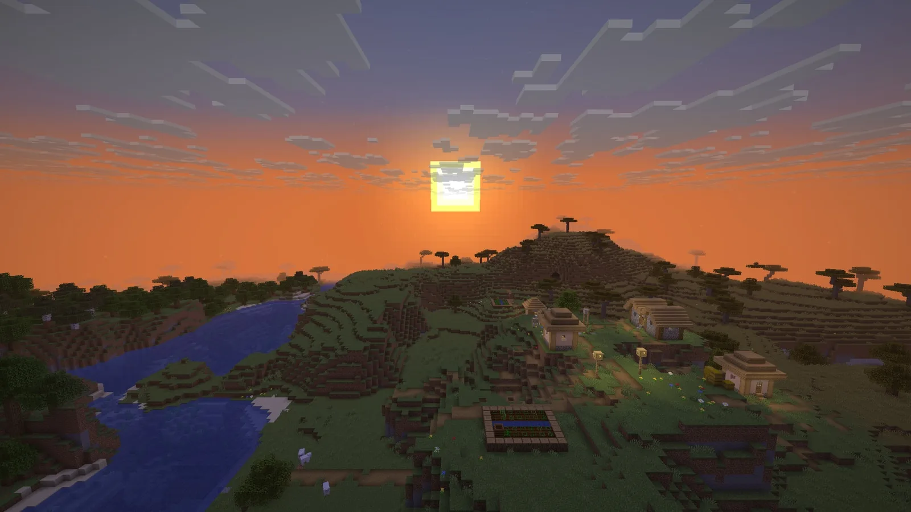
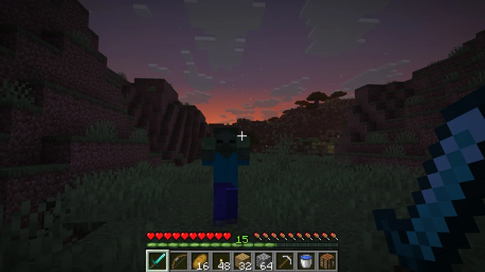
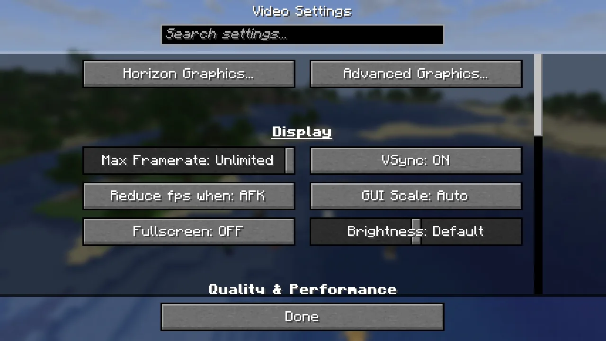
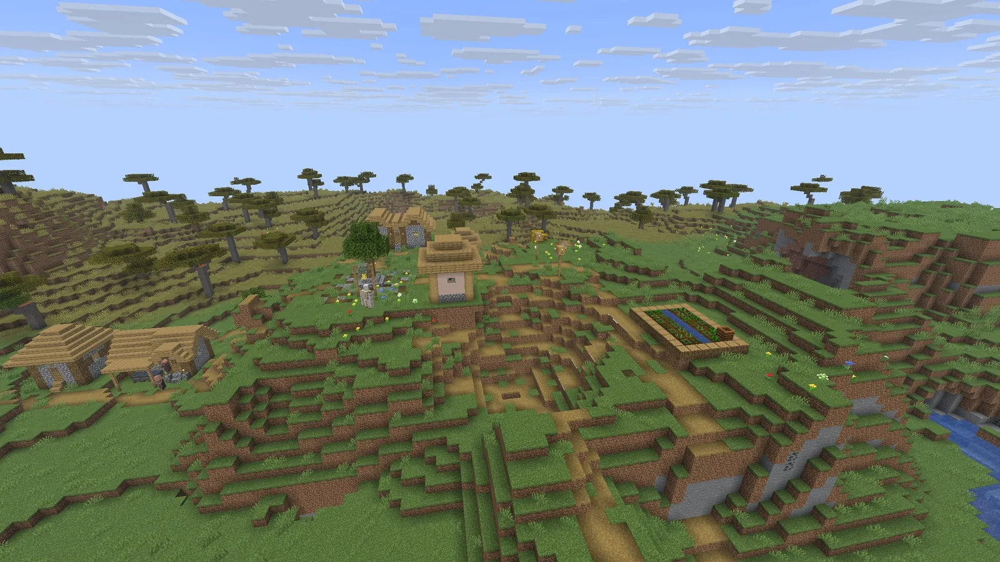
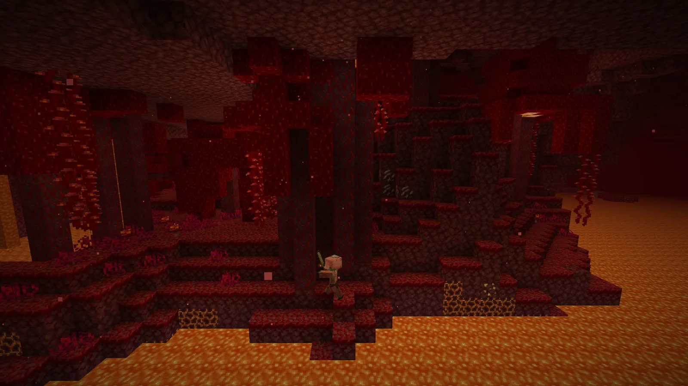

<p align="center">
  
</p>

<p align="center">
  <a href="https://github.com/tubers9999/horizon-android/actions"></a>
  
  
  
  
  <a href="LICENSE"></a>
</p>

<p align="center">
  <a href="#android-apk-download"><b>Download APK</b></a> ·
  <a href="#touch-controls-layout"><b>Touch Controls</b></a> ·
  <a href="#what-works-today"><b>What Works</b></a> ·
  <a href="ROADMAP.md"><b>Roadmap</b></a> ·
  <a href="#licence"><b>Licence & Copyright</b></a>
</p>

# Horizon Android (ARM64)

Minecraft: Java Edition 26.3 rewritten in Rust — **ported to Android ARM64 by RedGlitchX**, featuring native on-screen virtual touch controls inspired by PojavLauncher and MojoLauncher. Free, open source and unofficial.

> Not an official Minecraft product, nor approved by or associated with Mojang or Microsoft. Horizon contains no Minecraft code, assets or data: you need your own copy of Java Edition 26.3.

---

## Android APK Download

Get the latest **Android ARM64 APK** from [GitHub Actions Artifacts](https://github.com/tubers9999/horizon-android/actions) or the [Releases page](https://github.com/tubers9999/horizon-android/releases).

* **Target Architecture:** `aarch64-linux-android` (ARM64 mobile devices).
* **Requirements:** Android 9.0+ with Vulkan 1.1+ or OpenGL ES 3.2 support.
* **Assets:** A valid Microsoft account owning Java Edition 26.3 to fetch vanilla resources.

---

## Touch Controls Layout (Pojav / Mojo Style)

This Android build introduces **direct in-engine virtual touch controls** in `crates/horizon-client-input/src/touch.rs`:

* **Left Side (Movement):** Responsive virtual D-Pad (Forward, Backward, Strafe Left, Strafe Right) with Sneak center-lock.
* **Right Side (Camera & Actions):** 
  * Swipe area for camera rotation (look drag).
  * Virtual Jump button.
  * Dedicated Attack (Left Click) and Use / Place Item (Right Click) action buttons.
* **Top Bar (Shortcuts):**
  * **Pause / Escape** menu button.
  * **Chat** toggle.
  * **Inventory** (E).
  * **Debug F3** and **Perspective F5** toggles.
  * **Drop Item** (Q).

---

## What works today

- **The game:** vanilla world generation, mobs, villagers, raids, redstone, every command, the HUD and the recipe book, on vanilla saves. Worlds from 1.8 to 26.2 are upgraded.
- **Mobile Touch Controls:** Direct virtual on-screen overlay controls mapped to player movement, looking, mining, and placing.
- **Extras:** new menus, graphics presets, distant terrain up to 1024 chunks, controllers, zoom, minimap and more.
- **Packs:** resource packs, and data packs with functions, predicates, item modifiers and world generation.
- **Multiplayer:** invite friends with a code, Open to LAN, join servers (online mode included).
- **Mods:** content mods (blocks, items, data) and native Rust mods.

In the Rust client, with vanilla assets and no mods or shaders:

<table>
  <tr>
    <td colspan="2"></td>
  </tr>
  <tr>
    <td width="50%"></td>
    <td width="50%"></td>
  </tr>
  <tr>
    <td width="50%"></td>
    <td width="50%"></td>
  </tr>
</table>

---

## Building from Source

To build the Android ARM64 package locally or in CI:

```bash
# Add Android ARM64 target
rustup target add aarch64-linux-android

# Install cargo-ndk
cargo install cargo-ndk

# Build client for ARM64
cargo ndk -t arm64-v8a build --package horizon-client-input --release
```

---

## Licence & Copyright

- **Original Project:** Copyright (c) 2026 Ludovic Marie and the Horizon contributors (Licensed under the [MIT License](LICENSE)).
- **Android ARM64 Port & Virtual Touch Controls:** Copyright (c) 2026 **RedGlitchX** ([@tubers9999](https://github.com/tubers9999)).
- Minecraft is a trademark of Mojang Synergies AB; its code and assets belong to Mojang and Microsoft under the [Minecraft EULA](https://www.minecraft.net/en-us/eula).

## Credits

- **Android Port & Touch Overlay:** [RedGlitchX](https://github.com/tubers9999)
- **Original Horizon Engine:** [Ludovic Marie](https://lu4ovic.com) ([@ludovic111](https://github.com/ludovic111))
