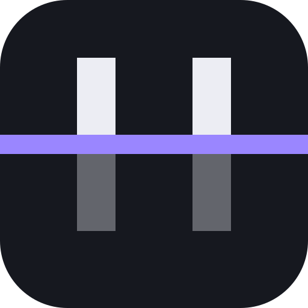
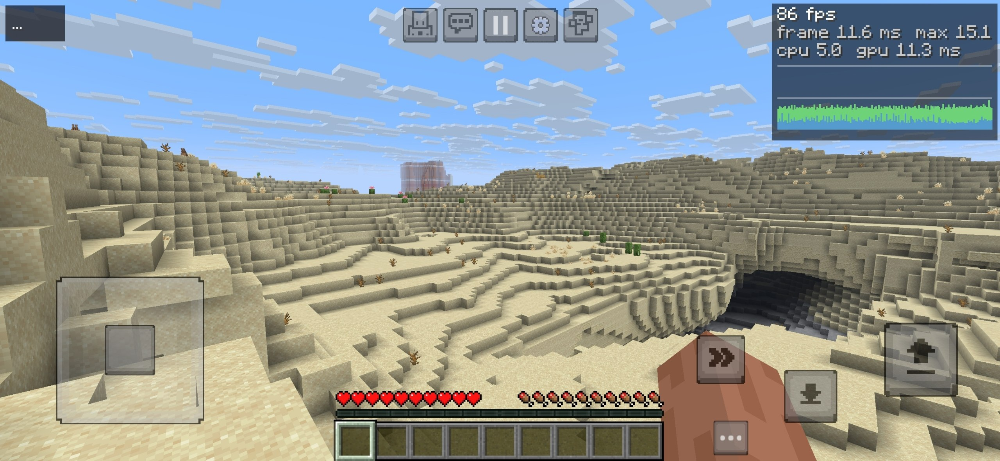
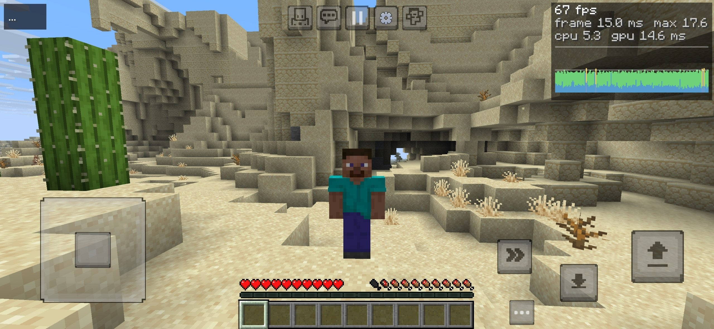

<div align="center">
  
  <h1>Horizon Android Edition</h1>
  <p><strong>Ultra-Fast Native Ahead-of-Time Rust Client for Minecraft Java Edition 26.3</strong></p>
  <p><em>Direct Vulkan Pipeline · Zero JVM Overhead · Sub-1.5s Cold Boots · WebAssembly Mods</em></p>
  <br>
  <p>
    <a href="https://github.com/tubers9999/apex/releases">Download APK</a> · 
    <a href="docs/">Documentation</a> · 
    <a href="https://github.com/horizon-rust/horizon">Upstream Horizon (PC)</a>
  </p>
</div>

---

### Unofficial Project & Collaboration Notice

Horizon is an independent community project. It is not affiliated with, endorsed by, or connected to Mojang Studios, Microsoft Corporation, or any of their subsidiaries. Minecraft is a registered trademark of Mojang Synergies AB.

- **PC Edition:** Created and maintained upstream by [Ludovic Marie (horizon-rust)](https://github.com/horizon-rust/horizon).
- **Android Port:** Maintained and optimized for ARM64 mobile hardware by [RedGlitchX (@tubers9999)](https://github.com/tubers9999).
- *Upstream team develops for PC; mobile optimizations and ARM64 tuning are ported and synchronized for Android players.*

---

## Core Characteristics

| Dimension | Horizon Android | Traditional JVM Wrapper |
| :--- | :--- | :--- |
| **Execution Architecture** | Native Rust (Ahead-of-Time) | OpenJDK HotSpot JVM |
| **RAM Footprint** | **~140–220 MB** | 1,200–2,500 MB |
| **Cold Startup Duration** | **&lt; 1.5 seconds** | 15–35 seconds |
| **Graphics Pipeline** | **Vulkan 1.1 (Naga WGSL)** | OpenGL via GL4ES |
| **Modding Sandbox** | **WebAssembly (`.hmod` via Wasmtime)** | Bytecode injection (Forge/Fabric unsupported) |
| **Garbage Collection** | **Deterministic RAII (0ms GC pause)** | Stop-the-world JVM GC cycles |
| **Touch Controls** | **Pojav & Bedrock + Polygon Outlines** | Virtual Java keyboard |

### Native Rust Ahead-of-Time Engine
Chunk meshing and terrain streaming run on native threads without intermediate Java object allocation, eliminating Garbage Collection spikes during chunk generation.

### Direct Vulkan 1.1 Pipeline
Custom WGSL shaders compiled with Naga communicate directly with Qualcomm Adreno and ARM Mali GPU drivers, bypassing OpenGL translation layers.

### WebAssembly Sandboxed Modding (.hmod)
Mod extensions compile to WebAssembly (`.hmod`) and run in a deterministic, memory-safe Wasmtime sandbox with strict capability boundaries.

### Zero-Latency PvP Feedback & Overlays
- **PvP Hitmarker Synthesizer:** Zero-latency in-memory PCM audio feedback synchronized with visual hitmarker feedback upon striking targets.
- **Keystrokes & CPS Visualizer:** Live WASD and Space overlay with a 1,000ms sliding-window frequency tracker for Left and Right click speeds.
- **Hardware Performance Optimization:** 1-tap entity and cave occlusion culling tuned for mobile chipsets.

---

## Gameplay & Mobile Screenshots

Authentic captures from the native Android port across touch navigation, world generation, and multiplayer:

| Joystick Navigation & Crosshair Targeting | D-Pad Controls & Gesture Touch Aiming |
| :---: | :---: |
|  |  |

| Multiplayer Network Play (Hypixel Arcade) | Native Chunk Meshing & World Generation |
| :---: | :---: |
|  |  |

| Vulkan Atmospheric Lighting & Desert Terrain | Third-Person Perspective & Dynamic FOV |
| :---: | :---: |
|  |  |

---

## Supported Version Matrix

Horizon targets an exact engine specification verified against upstream test suites.

| Target | Architecture | Supported | Status |
| :--- | :--- | :--- | :--- |
| **Minecraft Java 26.3** | ARM64-v8a | Yes | Verified cryptographically against `research-lock.json` |
| **Minecraft Java 26.2** | Any | No | Unsupported |
| **Minecraft Java 1.20.x** | Any | No | Unsupported |
| **Forge / Fabric / NeoForge** | Any | No | Bytecode mods unsupported; use native `.hmod` |

---

## Legitimate Setup & Preparation

Horizon does not download or redistribute copyrighted Mojang assets. To build or run Horizon, you must provide your own legally purchased copy of Minecraft Java Edition 26.3.

1. **Verify Ownership**  
   Ensure you have an active Microsoft account with a legally purchased copy of Minecraft Java Edition 26.3.

2. **Prepare Inputs**  
   Run the prepare tool to extract official client assets and verify their SHA-1 signatures against `research-lock.json`:
   ```bash
   python3 tools/android_prepare.py --java-home "$JAVA_HOME"
   ```

3. **Install ARM64 Package**  
   Install the release package onto your ARM64 Android device:
   ```bash
   adb install -r dist/horizon-arm64.apk
   ```

---

<details>
<summary><strong>Versiunea în limba română (Romanian version)</strong></summary>

<br>

<div align="center">
  
  <h1>Horizon Ediția Android</h1>
  <p><strong>Client nativ Ahead-of-Time în Rust pentru Minecraft Java Edition 26.3</strong></p>
  <p><em>Pipeline Vulkan direct · Fără overhead JVM · Pornire în sub 1.5 secunde · Moduri WebAssembly</em></p>
</div>

### Notă privind caracterul neoficial și colaborarea

Horizon este un proiect comunitar independent. Nu este afiliat, aprobat sau asociat cu Mojang Studios, Microsoft Corporation sau oricare dintre filialele acestora. Minecraft este o marcă înregistrată a Mojang Synergies AB.

- **Ediția PC:** Creată și menținută upstream de [Ludovic Marie (horizon-rust)](https://github.com/horizon-rust/horizon).
- **Portarea Android:** Menținută și optimizată pentru dispozitive mobile ARM64 de [RedGlitchX (@tubers9999)](https://github.com/tubers9999).
- Pentru sincronizare upstream, paritate și colaborare, consultați [repository-ul oficial](https://github.com/horizon-rust/horizon).

### Caracteristici de bază

- **Execuție nativă în Rust:** Fără dependențe de mașina virtuală Java, eliminând ciclurile de pauză Garbage Collector.
- **Consum redus de memorie:** Rulează stabil într-o amprentă de ~140–220 MB RAM.
- **Randare prin Vulkan 1.1:** Pipeline direct WGSL/Naga optimizat pentru GPU-urile mobile Qualcomm Adreno și ARM Mali.
- **Moduri sigure în WebAssembly (`.hmod`):** Extensii izolate într-un sandbox Wasmtime cu memorie deterministă. Modurile clasice Forge/Fabric nu sunt suportate.
- **Feedback PvP & Keystrokes:** Semnal acustic și vizual instantaneu la lovituri în PvP, afișaj Keystrokes WASD și contor CPS.
- **Comenzi tactile avansate:** Presets Pojav și Bedrock, butoane poligonale configurabile și mouse virtual.

### Compatibilitate

Doar **Minecraft Java Edition 26.3** este suportat și implementat conform specificațiilor din `research-lock.json`. Versiunile mai vechi și modurile Java nu sunt compatibile.

### Pregătire și cerință de deținere legală

Horizon nu redistribuie resurse originale Mojang. Pentru a compila și rula clientul, este necesară propria copie licențiată de Minecraft Java Edition 26.3, verificată cu scriptul `tools/android_prepare.py`.

</details>
